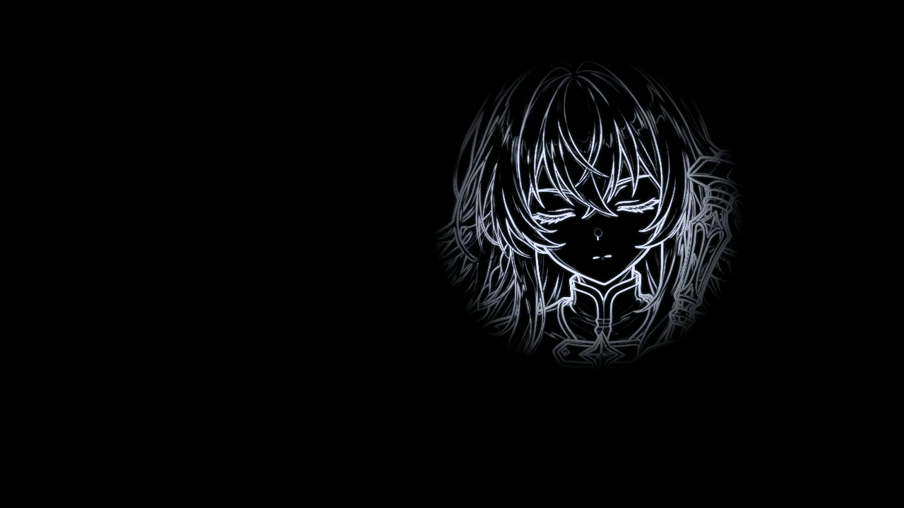
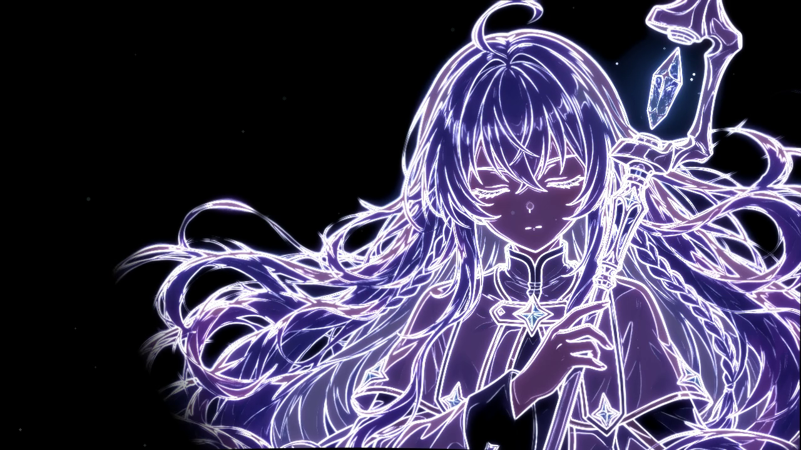
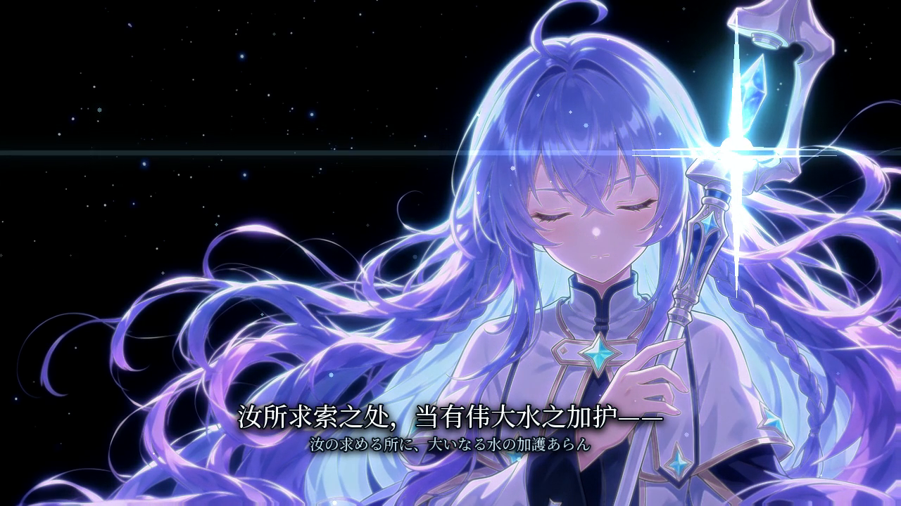
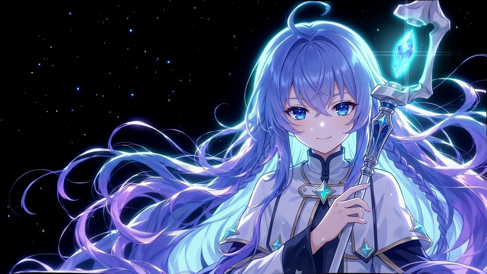
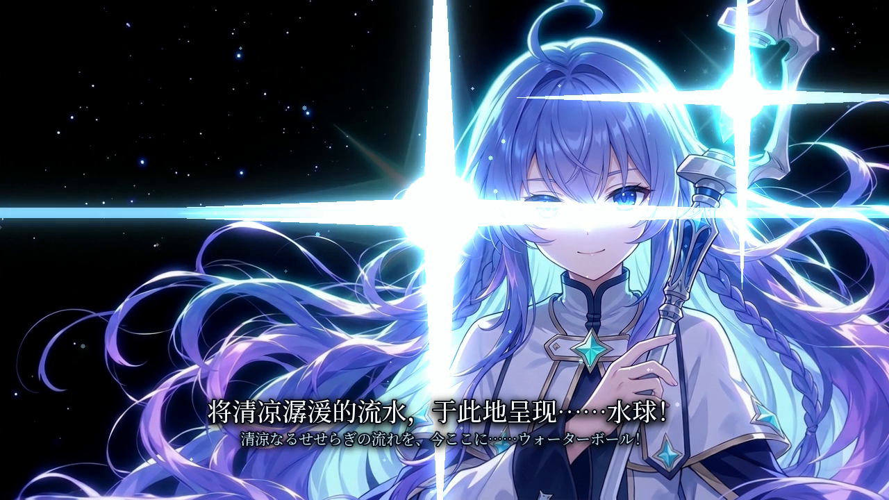
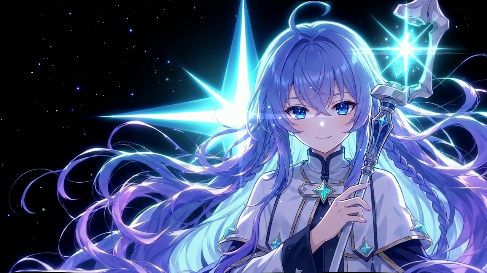
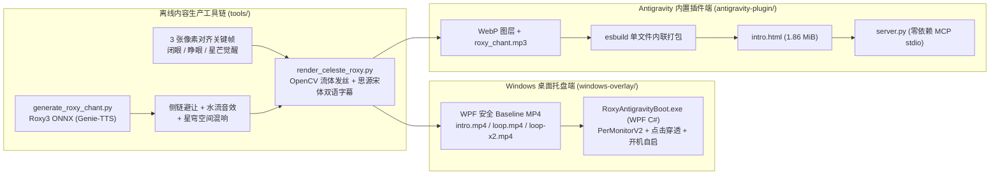
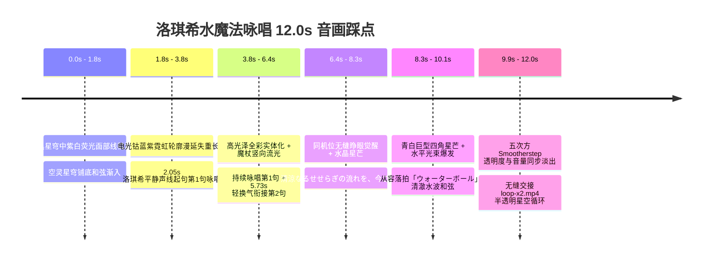

# Roxy Antigravity Boot Animation ✦ 洛琪希 Antigravity 开场动画

[](./LICENSE)
[](#快速开始)
[](#方式二antigravity-内置侧栏插件洛琪希开场)

一个为 **Google Antigravity** 打造的《无职转生》**洛琪希·米格路迪亚（Roxy Migurdia）** 主题开场动画与半透明动态星空背景项目。

项目致敬并基于抖音创作者 **Celeste_云中纤** 开源的 [wynneceles/ai-boot-animations](https://github.com/wynneceles/ai-boot-animations) 方案，以**「纯黑星穹 + 一镜到底 + 洛琪希日语水魔法咏唱 + 思源宋体中日双语字幕」**为核心审美，同时提供 **Windows 桌面托盘自动触发叠加层** 与 **Antigravity 内置侧栏 MCP 插件** 两种形态，**全程不修改 Antigravity 任何本体文件**。

---

## 效果预览

> 从荧光线稿浮现 → 电光霓虹发丝涌现 → 闭眼法杖流光与水魔术咏唱 → 同机位睁眼觉醒 → 青白四角星芒「水球」释放 → 无缝流光待机循环。

| 0.8s 纯黑荧光线稿 | 2.6s 电光霓虹发丝 | 4.4s 闭眼流光 + 咏唱第 1 句 |
| :---: | :---: | :---: |
|  |  |  |

| 7.4s 同机位无缝睁眼 | 8.6s 四角星芒爆发 + 水球释放 | 12.0s+ 无缝半透明星空循环 |
| :---: | :---: | :---: |
|  |  |  |

---

## 1. 这是什么（What）

本项目是一套开箱即用的 **Antigravity 角色启动仪式 & 桌面动态氛围层**，包含两个完全同步的模块：

1. **Windows 桌面托盘叠加层（`windows-overlay/`）**
   - 常驻 Windows 系统托盘（蓝青色四芒星 `✦`），静默监听 `Antigravity.exe` 进程启动；
   - 每次打开 Antigravity 时自动覆盖主窗口播放 **12 秒带配乐与洛琪希水球咏唱** 的完整开场动画；
   - 在 `9.9s – 12.0s` 通过五次方缓动曲线平滑淡入为 **可点击穿透、透明度可调（0%–80%）** 的流光长发星空动态背景，不影响日常写代码与任何鼠标键盘操作。
2. **Antigravity 内置侧栏插件（`antigravity-plugin/`）**
   - 符合 Antigravity **MCP App** 规范的自包含单文件插件（`intro.html` 仅 `1.86 MiB`，内联全部 WebP 图层与 `188 KiB` 咏唱音轨）；
   - 安装后直接出现在 Antigravity 左侧 Plugins 栏的 **「洛琪希开场」**，零外部进程、支持随时重播、切换全亮壁纸观赏与柔暗星尘收尾。

---

## 2. 为什么这样设计（Why）

| 设计痛点 | 传统魔改做法的隐患 | 本项目的解决方案 |
| :--- | :--- | :--- |
| **Antigravity 更新冲刷** | 直接改写 Electron `app.asar` 或原生二进制文件，既破坏数字签名，又在每次自动更新后失效 | **零入侵外置浮层**（`WS_EX_TRANSPARENT \| WS_EX_LAYERED \| WS_EX_NOACTIVATE`）+ 官方 **MCP App 侧栏插件**双形态并行 |
| **WPF 视频花屏与黑屏** | 默认 `libx264 High` + B 帧 + 超长 GOP 在 Windows WPF `MediaElement` 下极易丢首帧（黑屏）并导致暗绿参考帧花屏 | 全部视频采用 **H.264 `Constrained Baseline` + `0 B 帧` + 每 0.5 秒完整关键帧（`-g 15`）**，且等待首帧解出（`t ≥ 0.04s`）后再平滑淡入 |
| **多屏不同 DPI 缩放偏移** | 旧版 `SetProcessDPIAware()` 在 150% 笔记本主屏 + 100% 外接副屏间拖动时，浮层会被系统错误缩成 2/3 并飞出窗口 | 嵌入 **`PerMonitorV2`** 清单 + `SetProcessDpiAwarenessContext` + `WM_DPICHANGED` 与 `Follow()` 物理像素实时校位，跨任意多屏严丝合缝 |
| **普通人声 TTS 违和感** | 通用播音腔或战斗嘶吼声线与洛琪希冷静温柔的师匠气质不符 | 使用 `Roxy3` ONNX（`Genie-TTS`）的 **`平静` 师匠参考声线** 整句自然合成《无职转生》原著水球咏唱，叠加侧链自动避让与星穹混响 |

---

## 3. 核心功能（Features）

- **一镜到底星穹演出（12.0s）**：纯黑零黑边、零多余 HUD，完整还原线稿 → 电光霓虹 → 高光赛璐璐闭眼 → 无缝睁眼 → 巨型四角星芒爆发的 6 拍节奏。
- **流体长发 Live2D 级微动**：使用 `cv2.remap` 空间位移场锁定面部、五官与傲慢水龙王之杖，仅让失重飘散的发梢周期性自然波动。
- **洛琪希原音色水魔术咏唱 + 双语字幕**：
  - `2.05s – 5.55s`：`汝所求索之处，当有伟大水之加护——` / `汝の求める所に、大いなる水の加護あらん`
  - `5.73s – 10.07s`：`将清凉潺湲的流水，于此地呈现……水球。` / `清涼なるせせらぎの流れを、今ここに……ウォーターボール`
- **五次方 Smootherstep 丝滑淡出**：起步与落点加速度均为 0，透明度与开屏音量同步渐弱，无生硬断层。
- **零闪黑重叠交接循环（`loop-x2.mp4`）**：双播放器在中点提前重叠接力，彻底消除传统单播放器播完重头时的黑帧闪烁，并带看门狗自愈（锁屏/休眠唤醒自动恢复）。
- **零 SDK 一键编译**：Windows 端直接调用系统自带 `.NET Framework 4.x` 的 `csc.exe`，无需安装 Visual Studio 或 .NET SDK。
- **多屏混合 DPI 严丝合缝**：完整支持 100% / 125% / 150% / 200% 多显示器自由拖动。

---

## 4. 怎么做到的：技术架构与管线（How）

### 系统架构



### 12 秒音画同步时间轴



---

## 5. 快速开始（Quick Start）

### 方式一：Windows 桌面托盘开机自启版（推荐）

系统要求：**Windows 10 / 11**（无需安装 Python、Node.js 或 .NET SDK）。

1. 克隆或下载本仓库到本地，进入 `windows-overlay/` 目录：
   - **仅单次试运行（不写开机自启）**：直接双击 **`仅本次试运行.cmd`**（首次运行会自动在 2 秒内完成编译，随后立即在当前 Antigravity 窗口上播放开场动画并弹出设置窗口）。
   - **安装为日常开机自启**：双击 **`安装开机自启.cmd`**（会自动编译并安装到空间最大的非系统盘 `AIBootAnimations\RoxyAntigravityBoot`，并写入 `HKCU:\Software\Microsoft\Windows\CurrentVersion\Run`）。
2. **日常控制**：右键 Windows 右下角托盘蓝青色 **`✦`** 图标，可随时：
   - 勾选/取消「播放开屏动画」「保留循环背景」；
   - 拖动调节 **背景不透明度（0%–80%）** 与 **开屏音量**；
   - 点击「播放一次开屏动画」或「关掉动画 / 背景」。
3. **一键卸载**：右键托盘 **`✦`** →「卸载洛琪希开机动画…」，或运行 `uninstall.ps1`（自动清除自启项与安装目录）。

---

### 方式二：Antigravity 内置侧栏插件（「洛琪希开场」）

系统要求：已安装 Python 3（运行零依赖 `server.py`）。

在仓库根目录执行：

```powershell
powershell -NoProfile -ExecutionPolicy Bypass -File .\antigravity-plugin\install-plugin.ps1
```

脚本会将预构建好的自包含插件复制到 `%USERPROFILE%\.gemini\config\plugins\roxy-intro\`。重启或刷新 Antigravity 后，在左侧 **Plugins** 栏点击 **「洛琪希开场」** 即可随时播放（支持 `ESC` 跳过、右下角切换 `咏唱 开/关`、`全亮观赏 / 柔暗收尾` 与 `↻ 重播`）。

---

## 6. 仓库目录结构

```text
roxy-antigravity-boot/
├── README.md                              # 项目文档
├── LICENSE                                # GNU GPL v3 开源协议
├── .gitignore                             # Git 忽略规则
├── docs/preview/                          # README 实拍预览图（6 帧）
├── windows-overlay/                       # 模块一：Windows 桌面托盘叠加层
│   ├── src/
│   │   ├── RoxyAntigravityBoot.cs         # WPF 浮层主程序（C# 5，系统自带 csc.exe 直编）
│   │   └── app.manifest                   # PerMonitorV2 多屏 DPI 清单
│   ├── assets/                            # WPF 安全 Baseline 成品 MP4（开箱即用）
│   │   ├── intro.mp4                      # 12.0s 洛琪希水球咏唱开场动画
│   │   ├── loop.mp4                       # 8.0s 无缝长发星空循环
│   │   └── loop-x2.mp4                    # 16.0s 重叠交接双倍循环
│   ├── build.ps1                          # 编译脚本
│   ├── install.ps1                        # 安装与开机自启脚本
│   ├── uninstall.ps1                      # 卸载脚本
│   ├── 仅本次试运行.cmd                    # 双击即体验
│   └── 安装开机自启.cmd                    # 双击安装自启
├── antigravity-plugin/                    # 模块二：Antigravity 官方 MCP App 侧栏插件
│   ├── plugin.json                        # 插件元信息
│   ├── mcp_config.json                    # MCP stdio 配置
│   ├── server.py                          # 零依赖 Python MCP App 服务端
│   ├── intro.html                         # 预打包自包含单文件 HTML（1.86 MiB）
│   ├── assets/logo.svg                    # 插件图标
│   ├── assets_src/                        # WebP 图层 + roxy_chant.mp3 + 时间轴配置
│   ├── src/                               # 前端源码（HTML / Canvas FX / 音频与导演逻辑）
│   ├── build.mjs                          # esbuild 单文件打包脚本
│   ├── package.json                       # 前端依赖清单
│   └── install-plugin.ps1                 # 一键安装插件脚本
└── tools/                                 # 模块三：二次创作工具链（可选）
    ├── generate_roxy_chant.py             # Roxy3 ONNX 咏唱语音合成脚本
    └── render_celeste_roxy.py             # 流体长发 + 双语字幕 + 混音 + Baseline MP4 渲染脚本
```

---

## 7. 二次创作与自定义指南（可选）

如果你想替换自己的角色插画、修改咏唱台词或重新打包内置插件：

1. **重新渲染 MP4 与双语字幕**（需 Python 3.10+、`opencv-python`、`numpy`、`pillow`、`scipy` 及 `ffmpeg`）：
   ```powershell
   # 放入你自己的 3 张像素对齐关键帧（roxy_closed / roxy_open / roxy_climax）
   python tools/render_celeste_roxy.py --keyframes-dir ./antigravity-plugin/assets_src --render-loop
   ```
2. **重新合成洛琪希台词干音**（需另行准备 `Genie-TTS` 与 `Roxy3` ONNX 模型目录）：
   ```powershell
   python tools/generate_roxy_chant.py --voice-root <你的_roxy-tts_目录>
   ```
3. **修改并重新打包内置插件前端**：
   ```powershell
   cd antigravity-plugin
   npm install
   npm run build
   powershell -NoProfile -ExecutionPolicy Bypass -File .\install-plugin.ps1
   ```

---

## 8. 开源协议、致谢与免责声明

- **开源协议**：本项目沿用上游 Windows 浮层框架的 **[GNU General Public License v3.0](./LICENSE)** 发布。
- **上游致谢**：
  - Windows 桌面零入侵浮层与无缝循环架构基于 **[wynneceles/ai-boot-animations](https://github.com/wynneceles/ai-boot-animations)**（Copyright © 2026 wynneceles, GPL-3.0）改编，致敬原作者 **Celeste_云中纤** 的创意与审美风格；
  - 语音合成工具链参考并使用了 **[Genie-TTS](https://github.com/High-Logic/Genie-TTS)** / **[GPT-SoVITS](https://github.com/RVC-Boss/GPT-SoVITS)**（MIT）与社区语音包 **`yuanwu2023/dsh-anime-pet`** 的 `Roxy3` 模型思路。
- **同人与版权声明**：
  - 角色「洛琪希·米格路迪亚（Roxy Migurdia）」及相关水魔术设定源自轻小说/动画《无职转生～到了异世界就拿出真本事～》，其知识产权归原作者及版权方所有。
  - **本项目仅供个人学习、桌面美化与同人交流，严禁任何形式的商业用途，严禁用于冒充他人声音或侵犯版权方权益。** 如有版权方异议，请提交 Issue，作者将第一时间下架相关音画素材。
